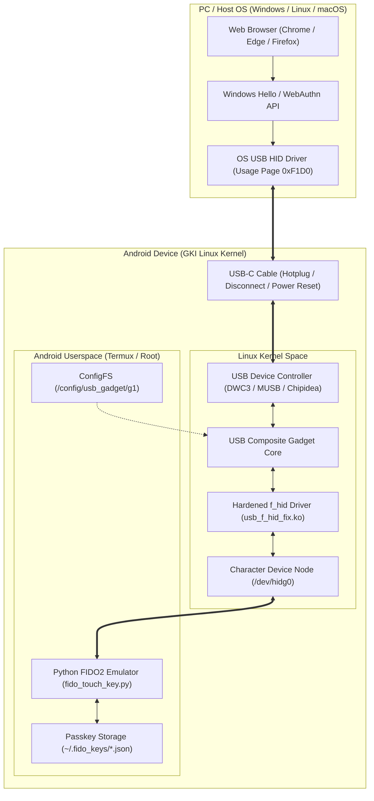
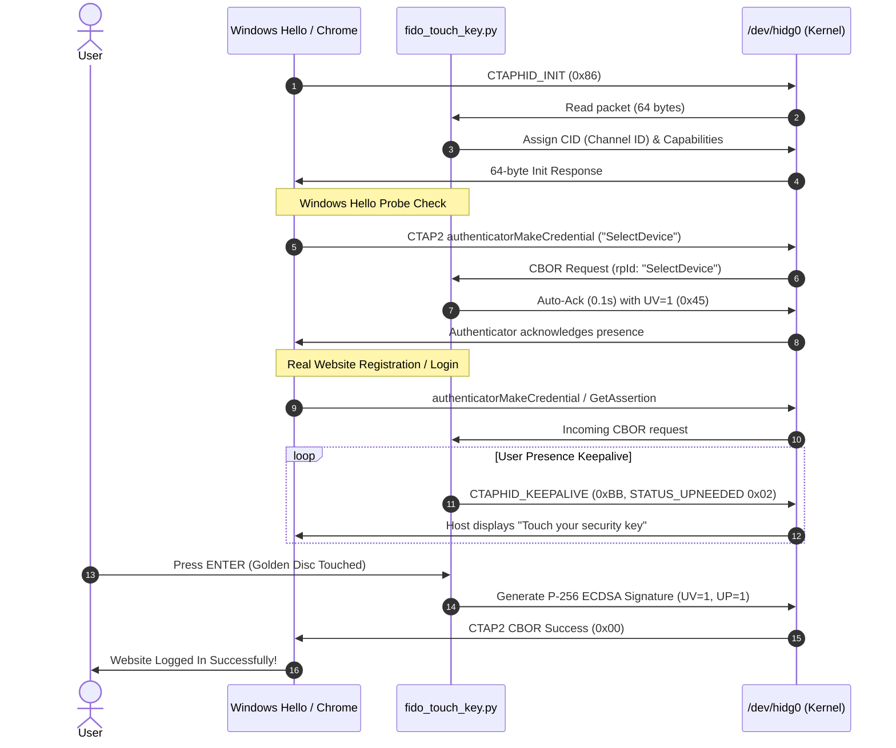

# Universal Hardened USB HID Gadget (`f_hid`) & FIDO2 Security Key Guide

This guide documents the engineering process, kernel driver fixes, ConfigFS gadget orchestration, and CTAP2 protocol implementation required to turn an Android device into a physical **FIDO2 / WebAuthn Hardware Security Key** that is hotplug-safe and reproducible on **any Android device** (Samsung, Google Pixel, Xiaomi, OnePlus, Motorola, etc.).

---

## 1. Architectural Overview



---

## 2. Root Cause Analysis: Upstream `f_hid.c` Panics

Upstream Linux kernel `drivers/usb/gadget/function/f_hid.c` was designed for embedded systems where USB cables are permanently attached or unbinding is rare. On modern Android devices with dynamic USB controllers (like Synopsys DesignWare Core 3 / `dwc3` found in Samsung Exynos, Qualcomm Snapdragon, and MediaTek Dimensity), running stock `f_hid` causes fatal kernel panics.

### Fatal Defect 1: Interrupt Completion NULL Pointer Dereference
When a USB cable is disconnected, the host resets the bus, or the Android USB HAL switches profiles, the composite gadget core disables functions and unlinks `f->config`. Any pending USB transfer requests in the hardware FIFO are immediately cancelled by the controller with statuses like `-ECONNRESET`, `-ESHUTDOWN`, or `-ECONNABORTED`.

**Upstream Code:**
```c
static void hidg_intout_complete(struct usb_ep *ep, struct usb_request *req) {
    struct f_hidg *hidg = (struct f_hidg *) req->context;
    struct usb_composite_dev *cdev = hidg->func.config->cdev; // CRASH! hidg->func.config is NULL!
    ...
    default:
        ERROR(cdev, "Set report failed %d\n", req->status); // Kernel Panic
}
```
**Fix:**
```c
static void hidg_intout_complete(struct usb_ep *ep, struct usb_request *req) {
    struct f_hidg *hidg = (struct f_hidg *) req->context;
    if (!hidg) {
        free_ep_req(ep, req);
        return;
    }
    // Safely ignore standard disconnect statuses without accessing cdev
    if (req->status != 0 && req->status != -ESHUTDOWN && req->status != -ECONNRESET) {
        if (hidg->func.config && hidg->func.config->cdev) {
            ERROR(hidg->func.config->cdev, "End Point Request ERROR: %d\n", req->status);
        }
    }
    ...
```

### Fatal Defect 2: Unchecked Char Device File Operations
If a userspace process (e.g. Python emulator) has `/dev/hidg0` open during disconnect, subsequent `read()`, `write()`, `poll()`, or `release()` calls attempt to dereference stale endpoint structures or call `ERROR(hidg->func.config->cdev, ...)` on disabled configurations.

**Fix:**
Guard every character device file operation with an immediate check:
```c
if (!hidg)
    return -ESHUTDOWN;
```

### Fatal Defect 3: Write Queue Deadlock on Cable Disconnect
In upstream `f_hid.c`, `WRITE_COND` was defined as `(!hidg->write_pending)`.
When the host pulls the cable or gadget disables, `hidg_disable()` sets `hidg->write_pending = 1` and calls `wake_up_interruptible(&hidg->write_queue)`. Any writer thread waiting in `wait_event_interruptible_exclusive(hidg->write_queue, WRITE_COND)` wakes up, evaluates `WRITE_COND`, sees `!1 == 0` (false), and **falls back asleep indefinitely**, deadlocking the thread and locking the device node.

**Fix:**
```c
#define WRITE_COND (!hidg->write_pending || hidg->disabled || !hidg->req)
...
while (!WRITE_COND) {
    spin_unlock_irqrestore(&hidg->write_spinlock, flags);
    if (file->f_flags & O_NONBLOCK)
        return -EAGAIN;
    if (wait_event_interruptible_exclusive(hidg->write_queue, WRITE_COND))
        return -ERESTARTSYS;
    spin_lock_irqsave(&hidg->write_spinlock, flags);
}

if (hidg->disabled || !hidg->req) {
    spin_unlock_irqrestore(&hidg->write_spinlock, flags);
    return -ESHUTDOWN; // Exit immediately on disconnect!
}
```

### Fatal Defect 4: Idempotent Unbind Sequence
When unlinking the function from ConfigFS, upstream `hidg_unbind` did not disable active endpoints before deleting character devices.

**Fix:**
```c
static void hidg_unbind(struct usb_configuration *c, struct usb_function *f) {
    struct f_hidg *hidg = func_to_hidg(f);
    hidg_disable(f); // Flush and disable endpoints cleanly first
    cdev_device_del(&hidg->cdev, &hidg->dev);
    usb_free_all_descriptors(f);
}
```

---

## 3. How to Build the Hardened Module for ANY Android Device

Android 12+ devices run Google's **Generic Kernel Image (GKI)**. This means the core kernel shares an identical Kernel Module Interface (KMI) across all manufacturers. You do **not** need the full manufacturer kernel source tree; you only need the GKI kernel headers and the matching `Module.symvers`.

### Step 1: Identify Target Kernel & KMI Version
On the target Android device (via Termux or ADB):
```bash
uname -r
# Example: 5.15.153-android14-11-29497047-abS928BXXU1AXB5
```
Here:
- Kernel major/minor: `5.15`
- Base commit: `android14-5.15`

### Step 2: Extract Reference `Module.symvers`
`Module.symvers` contains the exact symbol CRCs (e.g. `module_layout`, `usb_ep_queue`).
You can obtain it via:
1. Google AOSP GKI release builds: [android.googlesource.com/kernel/common](https://android.googlesource.com/kernel/common)
2. Or extract from boot image / `/proc/kallsyms`.

### Step 3: Out-of-Tree Makefile
Structure an isolated directory (`f_hid_fix/`):
```makefile
obj-m := usb_f_hid_fix.o
usb_f_hid_fix-y := f_hid.o

KDIR ?= /path/to/kernel/out
PWD := $(shell pwd)

default:
	$(MAKE) -C $(KDIR) M=$(PWD) modules
```

### Step 4: Automated GitHub Actions CI Workflow
You can compile this without installing gigabytes of Android Clang toolchains locally by using a GitHub Actions runner:

```yaml
name: Build Hardened f_hid Module
on: [workflow_dispatch]

jobs:
  build:
    runs-on: ubuntu-latest
    steps:
      - uses: actions/checkout@v4

      - name: Fetch Android Clang
        run: |
          mkdir -p clang
          curl -sSL "https://android.googlesource.com/platform/prebuilts/clang/host/linux-x86/+archive/refs/heads/master/clang-r450784d.tar.gz" | tar -xz -C clang

      - name: Fetch Kernel Headers & Build
        run: |
          export PATH=$GITHUB_WORKSPACE/clang/bin:$PATH
          make -C $KERNEL_OUT M=$(pwd)/f_hid_fix \
            ARCH=arm64 \
            CROSS_COMPILE=aarch64-linux-gnu- \
            LLVM=1 CC=clang LD=ld.lld \
            modules
```

---

## 4. Universal ConfigFS USB Gadget Orchestration

Every modern Android device uses the Linux ConfigFS gadget driver at `/config/usb_gadget/g1`.

### Finding the Hardware UDC (USB Device Controller)
To find the exact controller name on any phone:
```bash
ls /sys/class/udc
# Qualcomm:   a600000.dwc3 (or 4e00000.dwc3)
# Samsung:    13200000.dwc3 (or 10e00000.dwc3)
# MediaTek:   11201000.usb0 (or musb-hdrc)
# Google Tensor: 11110000.dwc3
```

### Official FIDO CTAPHID Report Descriptor (34 Bytes)
The USB HID descriptor tells the host OS that this device is a FIDO/U2F security key rather than a keyboard or mouse:

```python
FIDO_REPORT_DESC = bytes([
    0x06, 0xD0, 0xF1,  # Usage Page (FIDO Alliance: 0xF1D0)
    0x09, 0x01,        # Usage (CTAPHID: 0x01)
    0xA1, 0x01,        # Collection (Application)
    0x09, 0x20,        #   Usage (Data In)
    0x15, 0x00,        #   Logical Minimum (0)
    0x26, 0xFF, 0x00,  #   Logical Maximum (255)
    0x75, 0x08,        #   Report Size (8 bits)
    0x95, 0x40,        #   Report Count (64 bytes)
    0x81, 0x02,        #   Input (Data, Variable, Absolute)
    0x09, 0x21,        #   Usage (Data Out)
    0x15, 0x00,        #   Logical Minimum (0)
    0x26, 0xFF, 0x00,  #   Logical Maximum (255)
    0x75, 0x08,        #   Report Size (8 bits)
    0x95, 0x40,        #   Report Count (64 bytes)
    0x91, 0x02,        #   Output (Data, Variable, Absolute)
    0xC0               # End Collection
])
```

### The Hotplug-Safe Binding Shell Sequence
ConfigFS rejects modifying configurations (`EBUSY` / `EINVAL`) while the gadget is bound to the UDC. To safely configure without crashing:

```bash
UDC_NAME=$(ls /sys/class/udc | head -n 1)
GADGET="/config/usb_gadget/g1"
FUNC="$GADGET/functions/hid_fix.0"
CONFIG="$GADGET/configs/b.1"

# 1. Unbind UDC temporarily
echo "" > $GADGET/UDC
sleep 0.1

# 2. Configure HID Function
mkdir -p $FUNC
echo 0 > $FUNC/subclass
echo 0 > $FUNC/protocol
echo 64 > $FUNC/report_length
# (Write binary FIDO_REPORT_DESC to $FUNC/report_desc)

# 3. Symlink into primary configuration
ln -s $FUNC $CONFIG/f_hid

# 4. Re-bind to hardware controller
echo "$UDC_NAME" > $GADGET/UDC
chmod 666 /dev/hidg*
```

---

## 5. FIDO2 / WebAuthn & Windows Hello Specifications



### Critical WebAuthn Gotchas Resolved

| Issue / Symptom | Root Cause | Fix Applied |
| :--- | :--- | :--- |
| **"The PIN is incorrect. Try again"** | `authData` flags bit 2 (UV - User Verification) was 0 (`0x41`). Windows expects UV=1 when PIN is requested. | Set `flags = 0x45` (Bit 0 `UP=1`, Bit 2 `UV=1`, Bit 6 `AT=1`). |
| **Windows stuck searching for key** | Windows sends a dummy credential probe with `rpId: "SelectDevice"` before asking for PIN. If delayed or rejected, Windows aborts. | Automatically acknowledge `SelectDevice` in `< 0.1s` without prompting user. |
| **CBOR Decoding Failures** | Non-deterministic map key ordering or integer formatting in Python dictionary dumps. | Use canonical RFC 7049 CBOR formatting (`cbor2.dumps(..., canonical=True)`). |
| **Key format has `\n` in JSON** | Standard PEM private keys contain literal newlines. In JSON, these are escaped as `\n`. | Completely standard. Loaded via `load_pem_private_key()`. |

---

## 6. Reproducing on Other Devices (Step-by-Step)

1. **Kernel Module Storage:**
   Store `usb_f_hid_fix.ko` in vendor firmware storage:
   - Modern Android: `/data/vendor/fw/usb_f_hid_fix.ko` or `/data/vendor/firmware/usb_f_hid_fix.ko`
   - Fallback: `/data/local/tmp/usb_f_hid_fix.ko`
2. **Permissions:**
   ```bash
   chmod 644 /data/vendor/fw/usb_f_hid_fix.ko
   ```
3. **Module Loading:**
   ```bash
   insmod /data/vendor/fw/usb_f_hid_fix.ko
   ```

---

## 7. Android USB HAL Watchdog & Process Lifecycle Architecture

A critical discovery made during real-world hardware testing is the interaction between userspace process lifecycles and the Android USB Hardware Abstraction Layer (`vendor.samsung.hardware.usb-service` or AOSP `android.hardware.usb-service`).

### The `pkill` / UDC Race Condition Crash
If a userspace script unbinds UDC (`echo "" > /config/usb_gadget/g1/UDC`) during teardown, and the process is killed abruptly (via `pkill`, `SIGKILL`, or terminal disconnect) while UDC is detached:
1. The hardware USB DWC3 controller remains unlinked while Android framework properties (`sys.usb.config=mtp,adb`) expect active endpoints.
2. Active FunctionFS daemons (`adbd`, `mtp`) desynchronize and hang waiting for ep0 state recovery.
3. The Samsung / Android USB HAL watchdog detects that the hardware controller was detached behind its back without a property change, triggers a kernel restart timeout (`SEC_REBOOT` / `Kernel Restart: USB HAL Watchdog`), and reboots the phone.

### The Architectural Rule: Decouple Userspace from Hardware UDC State
Real hardware security keys (like YubiKeys) do not plug and unplug their USB controller when applications open or close. The USB HID interface remains statically presented to the host USB bus.

1. **Static Peripheral Binding:** Link `f_hid` into `/config/usb_gadget/g1/configs/b.1/f_hid` **once** when starting the key service. Leave it attached so the host sees a continuous, stable FIDO2 composite interface.
2. **Userspace Connection via File Descriptor:** The Python emulator simply opens `/dev/hidg0` when running, and closes `/dev/hidg0` when stopped.
3. **Driver Hardening Guarantees Safety:** Because `usb_f_hid_fix.ko` safely handles disconnects and queues without deadlocking, `/dev/hidg0` can be opened and closed repeatedly, or the USB cable can be pulled and replugged at any moment, without touching UDC.
4. **Manual Unbind Only:** Only unbind UDC and remove `f_hid` when the user explicitly requests to completely decommission the security key profile (e.g. Option 6 `--unbind`). Never perform hardware UDC toggles on routine script exit or crash handlers.

---

## 8. CVE-2026-31606 `cdev` Lifecycle, Module Exit & Userspace Poll Hardening

### Root Cause: UDC Rebind While `/dev/hidg0` Is Open
On Android devices with USB gadget monitors (for example Samsung `ss_mon.mtp` / `init.s5e8835.usb.rc` or `adbd` restarts), **USB selective suspend** (`USB_STATE=DISCONNECTED`) can trigger an automatic in-place ConfigFS UDC unbind and rebind (`hidg_unbind` followed milliseconds later by `hidg_bind`) **without unplugging the cable or closing userspace**.

In stock `f_hid.c`:
- `hidg_unbind()` called `cdev_device_del(&hidg->cdev, &hidg->dev)`.
- `hidg_bind()` called `cdev_init(&hidg->cdev, &f_hidg_fops)` and `cdev_device_add(&hidg->cdev, &hidg->dev)`.
- Calling `cdev_init()` on the same `struct f_hidg` while `/dev/hidg0` was still open in userspace `memset`-zeroed `cdev`, reset `cdev.kobj` refcounts, and re-initialized `cdev->list` while `inode->i_devices` remained linked on it—causing `cdev_put` refcount underflow (`use-after-free`) and `cd_forget()` `list_del corruption` kernel panics when the process later exited (`Ctrl+C` / `close()`), as well as leaving `/dev/hidg0` orphaned.

### Kernel & Userspace Fixes Applied
1. **Single-Lifetime `cdev_alloc` (`f_hid_fix/f_hid.c`):**
   - Moved `cdev_alloc()` + `cdev_device_add(hidg->cdev, &hidg->dev)` into `hidg_alloc()` and `cdev_device_del(hidg->cdev, &hidg->dev)` into `hidg_free()`. (Uses KMI-exported `cdev_alloc` and `cdev_device_add` directly, since `cdev_set_parent` is not exported in the GKI 5.15 KMI.)
   - `hidg_unbind()` now only calls `hidg_disable(f)` and `usb_free_all_descriptors(f)`, keeping `/dev/hidg0` and its `cdev` intact across UDC unbind/rebind cycles.
   - `f_hidg_open()` retrieves `hidg` via `container_of(inode->i_cdev->kobj.parent, struct f_hidg, dev.kobj)`.
2. **Request & Queue Guards (`f_hid_fix/f_hid.c`):**
   - Guarded `f_hidg_intout_read()` endpoint requeue against `disabled` / `!out_ep->enabled`, guarded `f_hidg_write()` (`hidg->req != req`), and freed stale `hidg->req` in `hidg_set_alt()`.
3. **Safe `rmmod` Unregistration (`f_hid_fix/f_hid.c`):**
   - Tracked `reg_hid_fix`, `reg_f_hid`, and `reg_hid` in `hidg_modinit()` / `hidg_modexit()` so `hidg_modexit()` never calls `usb_function_unregister()` on an alias whose registration returned `-EEXIST`.
4. **Non-Blocking Userspace I/O & CTAPHID Fixes (`fido_touch_key.py`):**
   - Polled `/dev/hidg0` with `select.select()` (`0.5s` read loop, `1.5s` `_safe_write_pkt()` write timeout) so stalled host IN polling cannot freeze Python.
   - Normalized `OSError` handling (`"shutdown" in str(e).lower()` and `errno in (5, 19, 32, 108)`) to survive UDC suspend/reset cleanly.
   - Allocated incrementing `next_cid` on `CTAPHID_INIT` (`0x86`) broadcast `0xFFFFFFFF`, handled `CTAPHID_CANCEL` (`0x91`), and returned `CTAPHID_ERROR` (`0xBF`) on unknown commands.

### Verification Summary (Galaxy A35 `SM-A356E`)
- Verified `usb_f_hid_fix.ko` loads cleanly (`insmod`), stays alive across an in-place ConfigFS UDC unbind/rebind while `fido_touch_key.py` holds `/dev/hidg0` open, exits cleanly on `SIGINT` with zero `dmesg` errors (`refcount`, `list_del`, `cd_forget`, `cdev_put`, `Oops`, `BUG`), and unloads/reloads cleanly via `rmmod` + `insmod`.
